# Azure End-to-End Data Engineering Project (AdventureWorks)

A beginner-friendly, step-by-step guide to build a complete data engineering project on Microsoft Azure, from raw data on GitHub to a Power BI report.

> All names used here (storage account, workspace, etc.) are examples. Use your own unique names.

---

## Table of Contents

1. [Project Overview](#1-project-overview)
2. [Architecture](#2-architecture)
3. [Tools Used](#3-tools-used)
4. [Basic Concepts You Should Know](#4-basic-concepts-you-should-know)
5. [Prerequisites](#5-prerequisites)
6. [The Dataset](#6-the-dataset)
7. [Phase 1: Data Ingestion with Azure Data Factory (Bronze)](#7-phase-1-data-ingestion-with-azure-data-factory-bronze)
8. [Phase 2: Data Transformation with Azure Databricks (Silver)](#8-phase-2-data-transformation-with-azure-databricks-silver)
9. [Phase 3: Serving Layer with Azure Synapse Analytics (Gold)](#9-phase-3-serving-layer-with-azure-synapse-analytics-gold)
10. [Phase 4: Connect Power BI](#10-phase-4-connect-power-bi)
11. [Common Errors and Fixes](#11-common-errors-and-fixes)
12. [Interview Questions Covered](#12-interview-questions-covered)
13. [Suggested Repository Structure](#13-suggested-repository-structure)
14. [Cost Saving Tips and Cleanup](#14-cost-saving-tips-and-cleanup)

---

## 1. Project Overview

In this project we:

- Pull data **directly from a GitHub repository using an HTTP connection (API)**, instead of uploading CSV files by hand.
- Store the data in **Azure Data Lake** using the **Medallion Architecture** (Bronze, Silver, Gold).
- Build **dynamic pipelines** in Azure Data Factory using parameters, a Lookup activity and a ForEach loop.
- Clean and transform the data with **PySpark in Azure Databricks**.
- Create a **data warehouse layer (serving layer)** in Azure Synapse Analytics using views and external tables.
- Connect **Power BI** to the Synapse data and build a few simple visuals.

---

## 2. Architecture

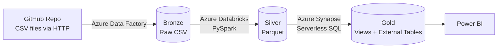

| Phase | What happens | Tool |
|-------|--------------|------|
| Phase 1 | Copy data from GitHub to the Bronze layer | Azure Data Factory |
| Phase 2 | Clean and transform Bronze data, save to Silver | Azure Databricks |
| Phase 3 | Create views and external tables, save to Gold | Azure Synapse Analytics |
| Phase 4 | Build reports | Power BI Desktop |

### What is the Medallion Architecture?

Data moves through three layers (also called zones):

| Layer | Other names | What it contains |
|-------|-------------|------------------|
| **Bronze** | Raw | An exact copy of the source data. **No changes at all.** |
| **Silver** | Transformed | Cleaned and transformed data. |
| **Gold** | Serving | Final data, ready for analysts, data scientists and managers. |

---

## 3. Tools Used

- **Azure Data Lake Storage Gen2** (storage)
- **Azure Data Factory** (ADF) (pipelines and orchestration)
- **Azure Databricks** (Spark transformations)
- **Azure Synapse Analytics** (serving layer, SQL)
- **Microsoft Entra ID** (app registration for access)
- **Managed Identity** (access between Azure services)
- **Power BI Desktop** (reporting)
- **VS Code** (to create the JSON parameter file)

---

## 4. Basic Concepts You Should Know

**Blob Storage vs Data Lake.** When you create a storage account, you get Blob Storage by default. If you tick **Hierarchical namespace**, it becomes a **Data Lake (ADLS Gen2)**. The difference: in a Data Lake you can create **folders inside folders** (container, then folder, then sub-folder, then file). Blob Storage cannot do this. Data Lake is better when you analyze data and build tables on it.

**Data redundancy.** How many copies of your data Azure keeps:
- **LRS** (Locally Redundant Storage): copies stay in the same data center. Cheapest. We use this.
- **GRS** (Geo Redundant Storage): copies are kept in different regions. This is the default.

**Access tiers.** **Hot** (data used often), **Cool** (used rarely, cheaper storage), **Cold/Archive** (cheapest storage, costs more to read). We use **Hot**.

**Four services in a storage account:** Containers (Data Lake), File shares, Queues (messages, streaming-type data), Tables (NoSQL key-value data).

**Linked Service.** A connection from Azure Data Factory to a system (like GitHub or Data Lake). Think of it as *the connection*.

**Dataset.** Tells Data Factory **which exact data** to use inside that connection (which file, which folder). Linked service = the door. Dataset = which room inside.

**Source and Sink.** Source = where data comes from. Sink = where data goes (destination).

**Parameters.** Variables that let one pipeline or dataset work for many files instead of hard-coding values.

**Managed Identity.** An "ID card" that every Azure resource gets automatically. We give this ID card permission to read/write the Data Lake, so no passwords are needed between Azure services.

---

## 5. Prerequisites

- A laptop or PC with a stable internet connection
- An **Azure Free Account**
- Basic interest in learning Azure data tools

### Create a free Azure account

1. Search **"Azure free account"** on Google and open the Microsoft page.
2. Click **Try Azure for free** (do **not** choose "Pay as you go").
3. Sign in with a Microsoft account (a Gmail address can be registered with Microsoft too).
4. Fill in your details and verify your phone number.
5. You get **free services for 12 months** and **$200 credit valid for 30 days**. This is enough for this project.
6. If Azure asks you to upgrade to Pay-as-you-go, you can decline.

Open the Azure Portal at **portal.azure.com**.

---

## 6. The Dataset

We use the popular **AdventureWorks** dataset. It has many tables, which is great for practicing joins, lookups and transformations. The CSV files are stored in a **GitHub repository** (in a folder named `Data`).

| File | Type | Description |
|------|------|-------------|
| Calendar | Dimension | Date column |
| Customers | Dimension | Customer name, address, birth date, etc. |
| Product Categories | Dimension | Product categories |
| Product Subcategories | Dimension | Product subcategories |
| Products | Dimension | Product details |
| Territories | Dimension | Sales regions |
| Sales 2015, 2016, 2017 | **Fact** | Three years of sales data |
| Returns | **Fact** | Returned products |

- **Fact tables** hold the business events (sales, returns).
- **Dimension tables** give extra context to the facts (who, what, where, when).

---

## 7. Phase 1: Data Ingestion with Azure Data Factory (Bronze)

**Goal:** Copy all CSV files from GitHub into the **bronze** container of the Data Lake.

### Step 1: Create a Resource Group

A Resource Group is a folder that keeps all your Azure resources together.

1. In the Azure Portal search bar, type **Resource groups** and click **Create**.
2. Name: `Vipin_project`
3. Region: choose a nearby region (example used: **East US**).
4. Skip Tags, click **Review + create**, then **Create**.

At the end of the project, your resource group holds all the project resources:

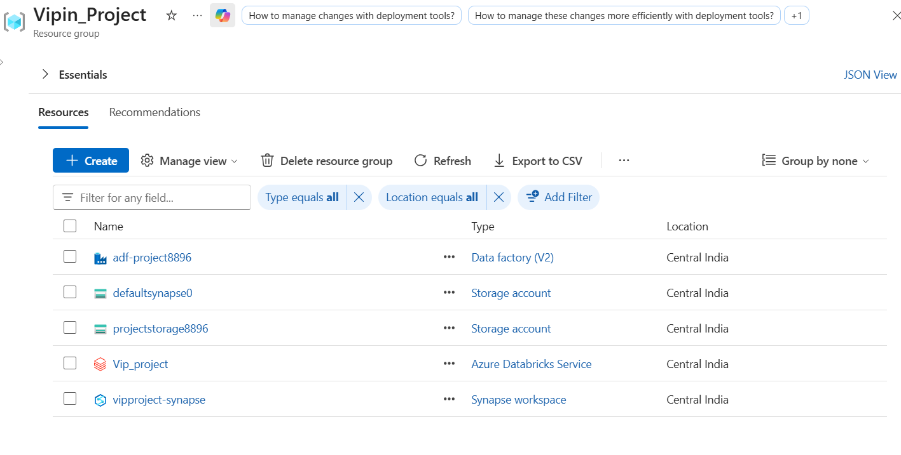

### Step 2: Create the Storage Account (Data Lake)

1. Search **Storage account**, click **Create**.
2. Resource group: `Vipin_project`
3. Storage account name: must be **globally unique**, for example `awstoragedatalakeprojectstorage8896`
4. Performance: **Standard**
5. Redundancy: **LRS** (Locally redundant storage)
6. In the **Advanced** tab, tick **Enable hierarchical namespace**. This makes it a Data Lake.
7. Access tier: **Hot**
8. Networking: keep public access enabled for this project.
9. **Review + create**, then **Create**.

### Step 3: Create Azure Data Factory

1. Search **Data Factory**, click **Create**.
2. Resource group: `aw-project`
3. Name: unique, for example `adf-aw-project-<yourname>`
4. **Review + create**, then **Create**.

Open it and click **Launch Studio**. The Data Factory Studio has these tabs:

| Tab | Purpose |
|-----|---------|
| Home | Start page |
| **Author** | Build pipelines (most important) |
| **Monitor** | See pipeline runs, status and errors |
| **Manage** | Linked services, Git connections |
| Learning Center | Docs and sample data |

### Step 4: Create the three containers

Go to your storage account, open **Containers**, and create:

- `bronze`
- `silver`
- `gold`

A fourth container, `parameters`, is added later for the JSON file (Step 7.4).

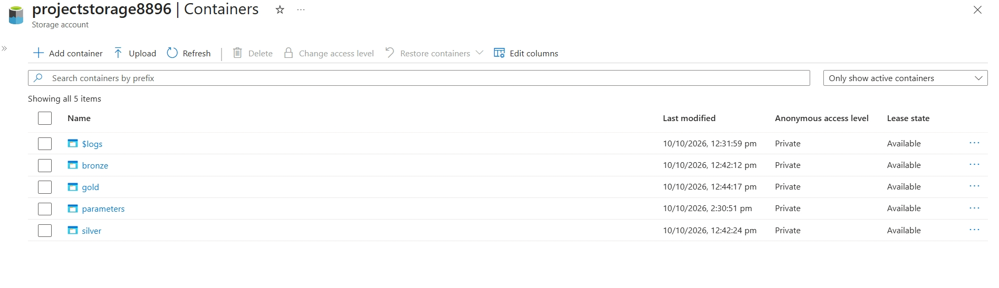

### Step 5: Create Linked Services (do this first, always)

Go to **Manage**, then **Linked services**, then **New**.

**A) HTTP linked service (for GitHub)**
- Type: **HTTP** (Microsoft recommends HTTP over REST when you only need to read files)
- Name: `HTTP_LinkedService`
- Base URL: the first part of the GitHub raw file URL, up to `.com` (for example `https://raw.githubusercontent.com`). Remove the trailing `/`.
- Authentication type: **Anonymous**
- Click **Test connection**, then **Create**.

A raw file URL has two parts:
- **Base URL:** `https://raw.githubusercontent.com`
- **Relative URL:** the rest, for example `/<github-user>/<repo>/main/Data/AdventureWorks_Products.csv`

> To get the raw URL: open the file on GitHub and click **Raw**.

**B) Data Lake linked service**
- Type: **Azure Data Lake Storage Gen2**
- Name: `Storage_DataLake_LinkedService`
- Pick your storage account.
- **Test connection**, then **Create**.

### Step 6: Build a simple (static) pipeline first

This helps you understand the basics before making it dynamic.

1. **Author** tab, click the `...` next to Pipelines, then **New pipeline**. Name: `get_to_raw`.
2. Open **Move and transform** and drag **Copy data** onto the canvas. Name it `copy_raw_data`.
3. **Source** tab: create a new dataset.
   - Type: **HTTP**, format: **CSV**
   - Name: `DS_HTTP`
   - Linked service: `HTTP_LinkedService`
   - Relative URL: paste the relative URL of `products.csv`
   - First row as header: **checked**
4. **Sink** tab: create a new dataset.
   - Type: **Azure Data Lake Storage Gen2**, format: **DelimitedText (CSV)**
   - Name: `DS_raw`
   - Linked service: the Data Lake one
   - Path: container `bronze`, directory `products`, file `products.csv`
   - First row as header: **checked**
   - If you see an "import schema failed" message, choose **None** (the file does not exist yet).
5. Click **Debug**. A green tick means success.
6. Click **Publish all** to save your work.

You can now check the `bronze/products/` folder in the storage account to see the file.

### Step 7: Build the Dynamic Pipeline (the important part)

**Problem:** We have 8 to 10 files. Making one Copy activity per file is not how real projects work.

**Solution:** One Copy activity inside a **ForEach loop**. Only **three values** change for each file:

1. The relative URL (which file to read from GitHub)
2. The sink folder (which folder to save in)
3. The sink file name

So we turn these three values into **parameters**.

**Overall design:**

```
Lookup activity  -->  ForEach activity  -->  Copy activity (inside the loop)
(reads JSON list)     (loops over list)      (uses parameters for each file)
```

#### 7.1 Create the new pipeline
- New pipeline, name: `Dynamic_get_to_raw`.

#### 7.2 Create a parameterized source dataset
1. New dataset: **HTTP**, **CSV**, name `DS_git_dynamic`, same HTTP linked service.
2. Click **Advanced**, then **Open this dataset**.
3. Open the **Parameters** tab, add a parameter `p_rel_url` (type String).
4. In the Relative URL box, click **Add dynamic content** and select the parameter. It looks like this:
   ```
   @dataset().p_rel_url
   ```
   The same dataset now works for every file.

#### 7.3 Create a parameterized sink dataset
1. New dataset: **Data Lake Gen2**, **CSV**, name `DS_sink_dynamic`, same Data Lake linked service.
2. Open the dataset and add two parameters: `p_sink_folder` and `p_sink_file`.
3. Container: `bronze` (fixed). Directory: `@dataset().p_sink_folder`. File name: `@dataset().p_sink_file`.

#### 7.3b What a dataset parameter looks like
In the Copy activity, the Source now asks for 1 value and the Sink asks for 2 values. In total, **3 values**. These will come from the ForEach loop.

#### 7.4 Create the JSON parameter file
Create a file named `git.json` in VS Code. It is a **list of dictionaries**. Each dictionary is one file to copy.

```json
[
  {
    "p_rel_url": "/<github-user>/<repo>/main/Data/AdventureWorks_Calendar.csv",
    "p_sink_folder": "AdventureWorks_Calendar",
    "p_sink_file": "AdventureWorks_Calendar.csv"
  },
  {
    "p_rel_url": "/<github-user>/<repo>/main/Data/AdventureWorks_Customers.csv",
    "p_sink_folder": "AdventureWorks_Customers",
    "p_sink_file": "AdventureWorks_Customers.csv"
  }
]
```

Add one block for **each** file (Calendar, Customers, Product Categories, Product Subcategories, Products, Returns, Sales 2015, Sales 2016, Sales 2017, Territories).

Upload this file to a new container named **`parameters`** in your storage account.

#### 7.5 Add the Lookup activity
1. Drag a **Lookup** activity, name it `lookup_git`.
2. Create a new dataset: **Data Lake Gen2**, format **JSON**, name `DS_git_parameters`, pointing to `parameters/git.json`.
3. **Very important:** **Untick "First row only"**. If you leave it ticked, Lookup returns only the first item and your loop runs just once.

Tip: To test only one activity, set the other activities to **Deactivated** (Activity state, in the General tab), then click Debug. Open the output of the Lookup activity to see the list inside a key called `value`.

#### 7.6 Add the ForEach activity
1. Drag a **ForEach** activity and connect Lookup to it with the green **On success** line.
2. In **Settings**, tick **Sequential** (keeps things in order).
3. In **Items**, click **Add dynamic content** and enter:
   ```
   @activity('lookup_git').output.value
   ```
   Interview point: you need `.value` because the list is stored inside the `value` key of the output.

#### 7.7 Put the Copy activity inside ForEach
1. Cut your Copy activity (Ctrl + X).
2. Click the **pencil icon** in the ForEach **Activities** tab to open its inner canvas.
3. Paste the Copy activity (Ctrl + V).
4. Fill the parameters using `@item()`. Each loop round, `item()` is one dictionary from the JSON list:

| Parameter | Value |
|-----------|-------|
| Source: `p_rel_url` | `@item().p_rel_url` |
| Sink: `p_sink_folder` | `@item().p_sink_folder` |
| Sink: `p_sink_file` | `@item().p_sink_file` |

> **Note:** The parameter name in the dataset and the key name in the JSON file do **not** have to be the same. But whatever key name you wrote in the JSON is the one you must use after `@item().`. A wrong key name is a common cause of failure.

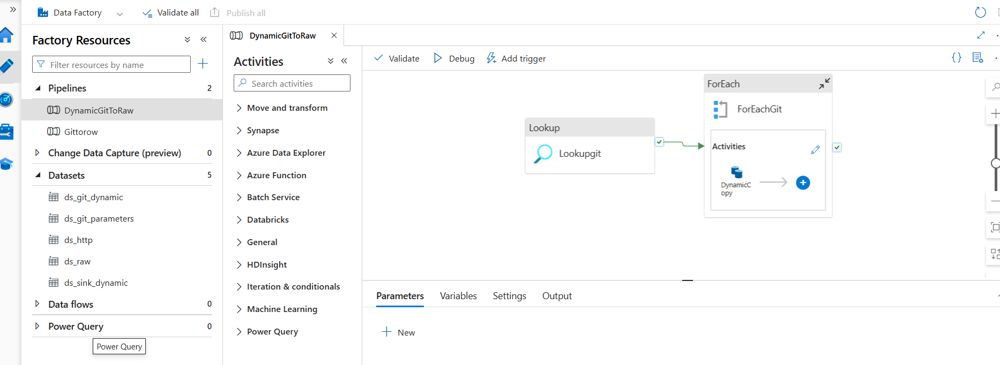

#### 7.8 Run and check
- Click **Debug**. When everything is green, open the `bronze` container. You should see one folder per file, each with its CSV inside.
- Click **Publish all**.

The Output tab shows one Lookup, one ForEach and ten Copy activities, all succeeded:

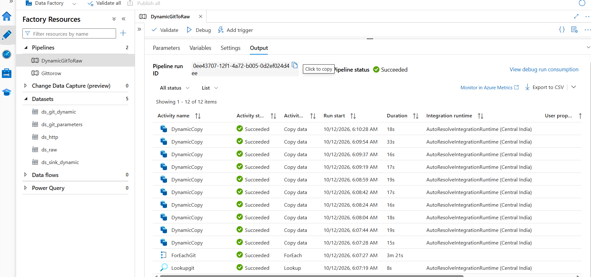

The bronze container now has one folder per source file (the small `products` folder comes from the first static pipeline test):

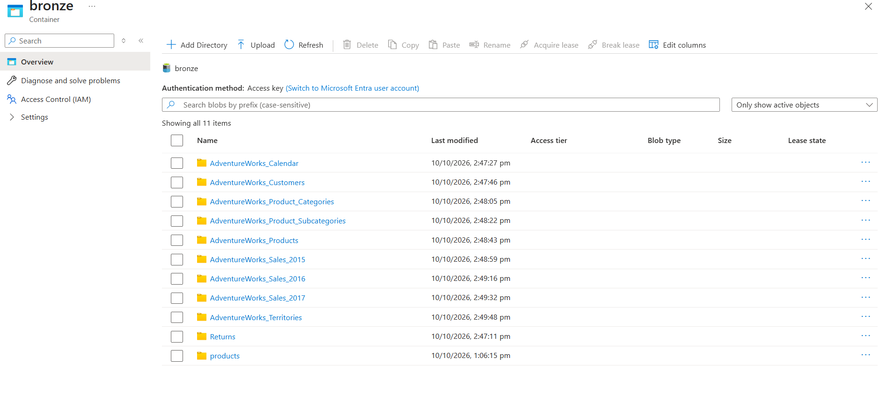

**Phase 1 complete.**

---

## 8. Phase 2: Data Transformation with Azure Databricks (Silver)

**Goal:** Read data from `bronze`, transform it with PySpark, and write it to `silver` in **Parquet** format.

### Step 1: Create the Databricks workspace

1. Search **Azure Databricks**, click **Create**.
2. Resource group: `aw-project`. Workspace name: `adb-aw-project`.
3. Pricing tier: Premium or Trial.
4. Managed resource group name: for example `managed-adb-aw-project`. (Databricks keeps the virtual machines and network settings of the clusters here, and manages them for you.)
5. Keep the defaults on the other tabs, then **Review + create**, then **Create**.
6. Open the resource and click **Launch workspace**.

### Step 2: Create a cluster (compute)

Go to **Compute**, then **Create compute**:

| Setting | Value used |
|---------|-----------|
| Name | `aw-project-cluster` |
| Node type | **Single node** (cheap, enough for this data) |
| Access mode | Single user (or No isolation shared) |
| Runtime | **14.3 LTS** (15.4 LTS also works if available). LTS = long-term support |
| Node size | General purpose, `Standard_DS3_v2` (4 cores) |
| Terminate after | **20 minutes** of inactivity (saves cost) |
| Photon acceleration | Off |

### Step 3: Give Databricks access to the Data Lake

The Data Lake and Databricks are separate resources. Databricks needs a "ticket" to enter the Data Lake. We create an **app registration (service principal)** as this ticket.

**3.1 Register an application**
1. In the Azure Portal, search **Microsoft Entra ID**.
2. Open **App registrations**, click **New registration**.
3. Name: `aw-project-app`, then **Register**.
4. Save these values in a private notepad (not on GitHub):
   - **Application (client) ID**
   - **Directory (tenant) ID**

**3.2 Create a client secret**
1. In the app, open **Certificates & secrets**, then **New client secret**.
2. Add a description and choose an expiry (6 months is fine for this project).
3. Copy the **Value** (not the Secret ID). You will not see it again.

**3.3 Give the app permission on the storage account**
1. Open your storage account, then **Access Control (IAM)**.
2. **Add**, then **Add role assignment**.
3. Role: **Storage Blob Data Contributor** (read and write).
4. Select members: search for your app (`aw-project-app`) and select it.
5. **Review + assign**.

> The role can take **10 to 15 minutes** to become active.

### Step 4: Create a notebook

1. In Databricks, go to **Workspace**, create a folder `aw-project`.
2. Inside it, create a **Notebook** named `silver_layer`.
3. Connect it to your cluster using the **Connect** button.

**Tips for notebooks:**
- Run a cell: `Shift + Enter` (run and move on) or `Alt + Enter` (run and add a new cell below).
- For headings, change the cell language to **Markdown** or start a cell with `%md`. Example: `%md ### Read calendar data`.

### Step 5: Connect to the Data Lake from the notebook

Use the code from the official Databricks documentation ("Connect to Azure Data Lake Storage Gen2 and Blob Storage", service principal method). Replace the placeholders with your own values.

```python
storage_account = "<your-storage-account>"
client_id       = "<application-client-id>"
tenant_id       = "<directory-tenant-id>"
client_secret   = "<client-secret-value>"

spark.conf.set(f"fs.azure.account.auth.type.{storage_account}.dfs.core.windows.net", "OAuth")
spark.conf.set(f"fs.azure.account.oauth.provider.type.{storage_account}.dfs.core.windows.net",
               "org.apache.hadoop.fs.azurebfs.oauth2.ClientCredsTokenProvider")
spark.conf.set(f"fs.azure.account.oauth2.client.id.{storage_account}.dfs.core.windows.net", client_id)
spark.conf.set(f"fs.azure.account.oauth2.client.secret.{storage_account}.dfs.core.windows.net", client_secret)
spark.conf.set(f"fs.azure.account.oauth2.client.endpoint.{storage_account}.dfs.core.windows.net",
               f"https://login.microsoftonline.com/{tenant_id}/oauth2/token")
```

> **Security warning:** Never upload your real client secret, client ID or tenant ID to GitHub. Before you commit the notebook, replace these values with placeholders. (A safer long-term method is Databricks secret scopes or Azure Key Vault. This project uses the simple method for learning.)

> **Mistake to avoid:** Use the **Directory (tenant) ID**, not the **Object ID**. Using the object ID gives a connection error.

### Step 6: Import functions

```python
from pyspark.sql.functions import *
from pyspark.sql.types import *
```

This also gives you code suggestions while typing.

### Step 7: Read the data from Bronze

**URL format for Data Lake in Databricks:**

```
abfss://<container>@<storage-account>.dfs.core.windows.net/<folder>
```

```python
bronze = f"abfss://bronze@{storage_account}.dfs.core.windows.net"
silver = f"abfss://silver@{storage_account}.dfs.core.windows.net"

def read_csv(folder):
    return (spark.read.format("csv")
            .option("header", True)
            .option("inferSchema", True)
            .load(f"{bronze}/{folder}"))

df_cal    = read_csv("AdventureWorks_Calendar")
df_cus    = read_csv("AdventureWorks_Customers")
df_procat = read_csv("AdventureWorks_Product_Categories")
df_subcat = read_csv("AdventureWorks_Product_Subcategories")
df_pro    = read_csv("AdventureWorks_Products")
df_ret    = read_csv("Returns")
df_ter    = read_csv("AdventureWorks_Territories")
df_sales  = read_csv("AdventureWorks_Sales*")   # reads Sales 2015, 2016, 2017 together
```

> Use the **same folder names** you used in your `git.json` file.

**What do the options mean?**
- `header = True`: use the first row as column names.
- `inferSchema = True`: let Spark guess the data types (numbers, dates, text) so you do not define the schema by hand. Without it, every column is read as text.
- `Sales*` (wildcard `*`): reads all folders that start with that name. This is a useful tip for reading many files at once.

To look at a DataFrame: `display(df_cal)` (or `df_cal.display()`).

### Step 8: Transformations and writing to Silver

#### Spark write modes

| Mode | What it does |
|------|--------------|
| `append` | Adds new data to existing data |
| `overwrite` | Replaces existing data with the new data |
| `error` | Fails if data already exists |
| `ignore` | Does nothing (no error, no write) if data already exists |

#### Why Parquet?
Parquet is a **columnar** file format, fast for reading and widely used. Delta format is built on top of Parquet.

#### Calendar: create Month and Year (date functions)

```python
df_cal = (df_cal
          .withColumn("Month", month(col("Date")))
          .withColumn("Year",  year(col("Date"))))

df_cal.write.format("parquet").mode("append") \
      .option("path", f"{silver}/AdventureWorks_Calendar").save()
```

`withColumn` creates a new column. If you use an existing column name, it changes that column.

#### Customers: create Full Name (string functions)

First way, using `concat` and `lit` (`lit` is needed to add a constant like a space):

```python
df_cus = df_cus.withColumn(
    "FullName",
    concat(col("Prefix"), lit(" "), col("FirstName"), lit(" "), col("LastName"))
)
```

Better way, using `concat_ws` (you write the separator only once):

```python
df_cus = df_cus.withColumn(
    "FullName",
    concat_ws(" ", col("Prefix"), col("FirstName"), col("LastName"))
)

df_cus.write.format("parquet").mode("append") \
      .option("path", f"{silver}/AdventureWorks_Customers").save()
```

> **Note:** In the project notebook the full name was only previewed with `.display()`, so the saved silver Customers table keeps the original columns. To keep `FullName` in silver, assign the result back to the DataFrame (as shown above) before the write.

#### Products: split a column and take one part

- From `ProductSKU`, keep the part **before the hyphen**.
- From `ProductName`, also keep the part **before the first hyphen**.

```python
df_pro = (df_pro
          .withColumn("ProductSKU",  split(col("ProductSKU"), "-")[0])
          .withColumn("ProductName", split(col("ProductName"), "-")[0]))

df_pro.write.format("parquet").mode("append") \
      .option("path", f"{silver}/AdventureWorks_Products").save()
```

`split` turns the text into a list. `[0]` picks the first item (index 0).

#### Tables written without changes
Product categories, product subcategories, returns and territories are already clean, so they are written to Silver as they are:

```python
df_procat.write.format("parquet").mode("append").option("path", f"{silver}/AdventureWorks_Product_Categories").save()
df_subcat.write.format("parquet").mode("append").option("path", f"{silver}/AdventureWorks_Product_Subcategories").save()
df_ret.write.format("parquet").mode("append").option("path", f"{silver}/AdventureWorks_Returns").save()
df_ter.write.format("parquet").mode("append").option("path", f"{silver}/AdventureWorks_Territories").save()
```

> **Mistake to avoid:** When you copy and paste a write cell, always **change the folder name** in the path. Otherwise you write the wrong data into the wrong folder.

#### Sales: three transformations

```python
# 1) Convert StockDate to timestamp
df_sales = df_sales.withColumn("StockDate", to_timestamp(col("StockDate")))

# 2) Replace the letter "S" with "T" in OrderNumber
df_sales = df_sales.withColumn("OrderNumber", regexp_replace(col("OrderNumber"), "S", "T"))

# 3) Multiply two columns into a new column
df_sales = df_sales.withColumn("multiply", col("OrderLineItem") * col("OrderQuantity"))

df_sales.write.format("parquet").mode("append") \
        .option("path", f"{silver}/AdventureWorks_Sales").save()
```

> The multiply column has no real business meaning. It is only used to practice math operations on columns.

> Column names above follow the common AdventureWorks files. If yours are different, check them with `df.printSchema()`.

### Step 9: Simple sales analysis and charts (no extra code)

**Orders received per day (Group By + aggregation):**

```python
df_sales_daily = (df_sales
                  .groupBy("OrderDate")
                  .agg(count("OrderNumber").alias("TotalOrders")))
display(df_sales_daily)
```

After `display(...)`, click the **+** next to the Table tab, then **Visualization**. You can pick a line chart, area chart, bar chart or pie chart just by clicking. No plotting code is needed. Click **Save** to keep the chart in the notebook.

Charts created in this project:
1. **Line / area chart:** total orders per day (sales jumped from July 2016).
2. **Pie chart:** product category distribution.
3. **Chart on territories:** for example number of regions per country.

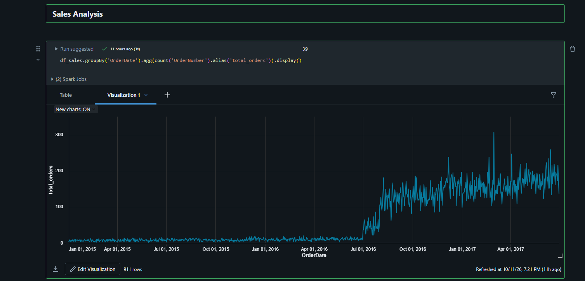

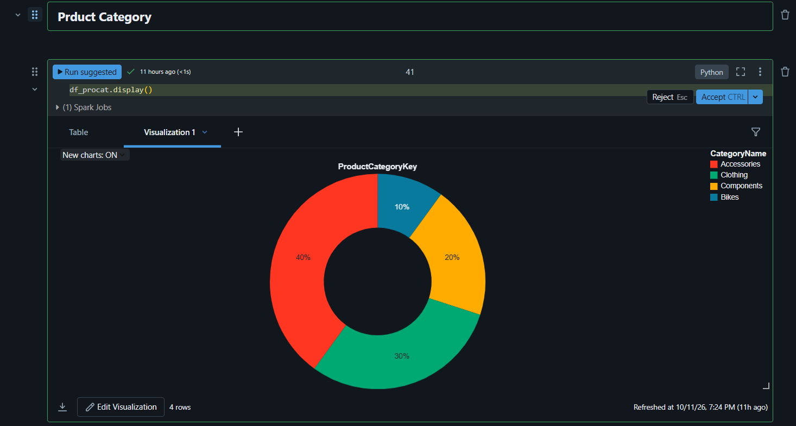

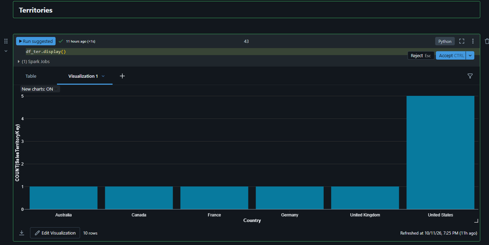

### Step 10: Check the result

Open the `silver` container in the storage account. You should see one folder per table, each with Parquet files.

**Phase 2 complete.**

---

## 9. Phase 3: Serving Layer with Azure Synapse Analytics (Gold)

**Goal:** Query Silver data using SQL, create views and external tables, and store the final data in the `gold` container.

### What is Azure Synapse Analytics?

A **unified platform** that combines three things in one workspace:

| Synapse tab | What it is | Similar to |
|-------------|------------|-----------|
| **Integrate** | Data pipelines | Azure Data Factory (same UI and features) |
| **Develop** | SQL scripts and Spark notebooks (Spark pool) | Databricks (but a different Spark management layer) |
| **Data** | SQL databases and Lake databases | Data warehouse |

### Step 1: Create the Synapse workspace

1. Search **Azure Synapse Analytics**, click **Create**.
2. Resource group: `aw-project`.
3. Workspace name: for example `aw-project-synapse`.
4. Managed resource group: for example `rg-managed-aw-project`.
5. **Storage account for the workspace:** create a new one (for example `defaultsynapse...`) and a new file system (for example `defaultfilesystem`). This is only the default storage of Synapse. Our project data stays in our own Data Lake.
6. Security tab: set the **SQL admin username** (for example `admin`) and a **password**. Remember them. You need them for Power BI.
7. Networking: keep managed virtual network **disabled**.
8. **Review + create**, then **Create**. Then open Synapse Studio from the resource.

### Step 2: Give permissions

Synapse is an Azure service, so we do not need an app registration. We use its **managed identity**.

**Role 1: for the Synapse workspace**
1. Storage account, **Access Control (IAM)**, **Add role assignment**.
2. Role: **Storage Blob Data Contributor**.
3. Assign access to: **Managed identity**. Select your Synapse workspace.

**Role 2: for yourself (your user account)**
1. Same steps, but this time choose **User, group or service principal** and select your own email.

> Wait 10 to 15 minutes after assigning roles. If you see a "cannot list data" error, wait a bit and try again.

### Step 3: Create a serverless SQL database

1. In Synapse Studio, open the **Data** tab, click **+**, then **SQL database**.
2. Choose **Serverless**. Name: `aw_database`.

#### Serverless vs Dedicated SQL pool

| | Dedicated SQL pool | Serverless SQL pool |
|---|---|---|
| Where data lives | Inside the database (traditional) | **Stays in the Data Lake** |
| How it works | Traditional data warehouse on the cloud | Creates only a **metadata layer** (column names and types) over the lake files |
| Cost | Higher | Lower, pay for what you query |
| Concept | Data warehouse | **Lakehouse** (Data Lake + Data Warehouse) |

In the lakehouse idea, the data stays cheaply in the Data Lake, but you query it with normal SQL as if it were in a database.

### Step 4: Query Silver data with OPENROWSET

Open **Develop**, create a **SQL script**, and make sure **Use database** is set to `aw_database` (the default is `master`, so change it).

```sql
SELECT *
FROM OPENROWSET(
    BULK 'https://<your-storage-account>.dfs.core.windows.net/silver/AdventureWorks_Calendar/',
    FORMAT = 'PARQUET'
) AS query1;
```

Points to remember:
- In the file URL copied from the portal, replace **`blob`** with **`dfs`**.
- Remove the file name. End the path at the **folder** (that is why we made one folder per table).
- Format is `PARQUET`.

The results can be exported (CSV, JSON, XML) or shown as a chart.

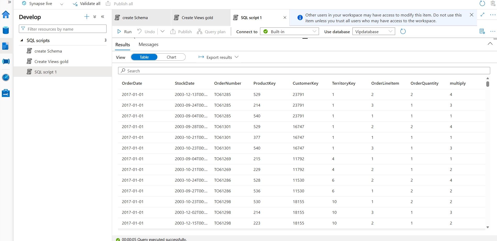

### Step 5: Create the Gold schema and views

```sql
CREATE SCHEMA gold;
```

Create one view for each table. Example for Calendar:

```sql
CREATE VIEW gold.calendar AS
SELECT *
FROM OPENROWSET(
    BULK 'https://<your-storage-account>.dfs.core.windows.net/silver/AdventureWorks_Calendar/',
    FORMAT = 'PARQUET'
) AS query1;
```

Repeat for all tables. Only the **view name** and the **folder name in the URL** change:

`gold.calendar`, `gold.customers`, `gold.products`, `gold.procat` (product categories), `gold.subcat` (product subcategories), `gold.returns`, `gold.sales`, `gold.territories`

Click **Publish all** to save. Now anyone can query without OPENROWSET:

```sql
SELECT * FROM gold.customers;
```

> A **view** stores only the **query**, not the data.

### Step 6: Create an External Table (CETAS)

An external table **stores the data physically** in the Data Lake (in the gold container), so the data is retained.

**CETAS** = **C**reate **E**xternal **T**able **A**s **S**elect.

Three things are needed before you create the table:

| Step | Object | Purpose |
|------|--------|---------|
| 1 | **Database scoped credential** | Tells Synapse to access the lake using managed identity |
| 2 | **External data source** | Short name for a container URL, so you do not repeat the full URL |
| 3 | **External file format** | Tells Synapse the files are Parquet |

**Prerequisite: master key** (run once in your database; use your own strong password with a capital letter and a special character)

```sql
CREATE MASTER KEY ENCRYPTION BY PASSWORD = '<your-strong-password>';
```

**Step 1: Credential**

```sql
CREATE DATABASE SCOPED CREDENTIAL cred_aw
WITH IDENTITY = 'Managed Identity';
```

**Step 2: External data sources** (one for silver, one for gold)

```sql
CREATE EXTERNAL DATA SOURCE source_silver
WITH (
    LOCATION   = 'https://<your-storage-account>.dfs.core.windows.net/silver',
    CREDENTIAL = cred_aw
);

CREATE EXTERNAL DATA SOURCE source_gold
WITH (
    LOCATION   = 'https://<your-storage-account>.dfs.core.windows.net/gold',
    CREDENTIAL = cred_aw
);
```

**Step 3: External file format**

```sql
CREATE EXTERNAL FILE FORMAT format_parquet
WITH (
    FORMAT_TYPE      = PARQUET,
    DATA_COMPRESSION = 'org.apache.hadoop.io.compress.SnappyCodec'
);
```

(Snappy compression gives good read performance and is recommended by Microsoft.)

**Create the external table from the sales view**

```sql
CREATE EXTERNAL TABLE gold.extsales
WITH (
    LOCATION    = 'extsales',
    DATA_SOURCE = source_gold,
    FILE_FORMAT = format_parquet
)
AS
SELECT * FROM gold.sales;
```

Check it:

```sql
SELECT * FROM gold.extsales;
```

Open the `gold` container in the storage account. You will see the `extsales` folder with Parquet files inside.

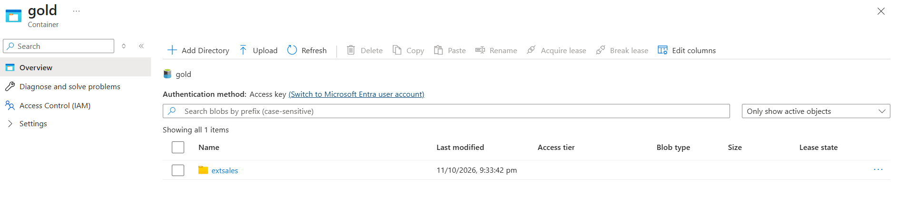

### View vs External Table

| | View | External table |
|---|---|---|
| Stores | Only the query | **The data** (in the gold container) |
| Output when queried | Same result | Same result |
| Data retained for future? | No | **Yes** |

> The SQL commands for credential, data source and file format are available in the Microsoft documentation. With practice you will remember them.

**Phase 3 complete.**

---

## 10. Phase 4: Connect Power BI

**Goal:** Show how a data engineer connects Synapse to Power BI (full report design is not the focus).

### Step 1: Get the SQL endpoint

1. Azure Portal, open your **Synapse workspace**.
2. On the Overview page, copy the **Serverless SQL endpoint** (do not use the dedicated one, because we did not create a dedicated pool).

### Step 2: Connect in Power BI Desktop

1. Download and install **Power BI Desktop** (search "Power BI download").
2. **Get data**, then **More...**, then **Azure**, then **Azure Synapse Analytics SQL**, then **Connect**.
3. Paste the SQL endpoint in the **Server** box. The database name is optional (`aw_database`).
4. If asked for credentials, choose **Database** and enter the **SQL admin username and password** you set when creating the Synapse workspace.
5. You will see your views and external tables. Select `gold.extsales` and click **Load**.

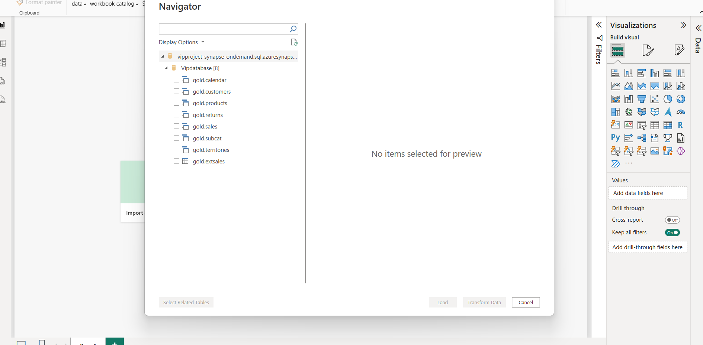

Power BI gets this data from Synapse, and Synapse reads it from the Data Lake. In the connection window you can choose **Import** (Power BI keeps a copy of the data inside the report) or **DirectQuery** (Power BI asks Synapse every time the report is opened or refreshed).

### Step 3: A few quick visuals

- **Line chart:** OrderDate on X-axis, OrderNumber on Y-axis (trend of orders).
- **Card:** CustomerKey (count) for total customers (about 56,000 in this dataset).
- **Area chart:** StockDate on X-axis, customers on Y-axis.

Add titles from the Format options.

---

## 11. Common Errors and Fixes

| Problem | Reason | Fix |
|---------|--------|-----|
| Storage account or resource name "already taken" | Names must be globally unique | Add your name or digits at the end |
| ForEach pipeline runs only once | Lookup "First row only" was ticked | **Untick** "First row only" |
| ForEach gets wrong data | Used `output` instead of `output.value` | Use `@activity('lookup_git').output.value` |
| Copy activity fails with a parameter error | Key name in the JSON does not match what you wrote after `@item()` | Use the exact key names from your JSON file |
| Databricks connection fails | Used **Object ID** instead of **Tenant ID** | Use the Directory (tenant) ID |
| "Cannot access / list data" right after assigning a role | Role assignment takes time | Wait 10 to 15 minutes |
| Wrong data in a Silver folder | Copied a write cell but did not change the folder path | Change the folder name every time |
| OPENROWSET path fails | Used `blob` in the URL or included a file name | Use `dfs` and end the path at the folder |
| Objects created in the wrong database | Synapse default database is `master` | Select `aw_database` in "Use database" |
| Spark function not found while typing | Functions not imported | Run `from pyspark.sql.functions import *` |
| Cluster cost is high | Cluster kept running | Set auto terminate to 20 minutes |

---

## 12. Interview Questions Covered

1. What is the difference between **Blob Storage and Data Lake**? (Hierarchical namespace)
2. What is **data redundancy**? LRS vs GRS?
3. What are **access tiers** (Hot, Cool, Cold)?
4. What is a **Linked Service** and what is a **Dataset**?
5. What is **Source** and **Sink**?
6. How do you build **dynamic pipelines** (parameters, Lookup, ForEach)?
7. Why do you untick **"First row only"** in Lookup? Why `output.value`?
8. What is the **Medallion Architecture**?
9. How does Databricks securely access the Data Lake? (**Service principal / app registration**)
10. What is `inferSchema`? What are the four **write modes**?
11. Why use **Parquet**?
12. `concat` vs `concat_ws`, and when do you need `lit()`?
13. How do you read many folders at once? (**Wildcard `*`**)
14. What is a **Managed Identity**?
15. **Serverless vs Dedicated** SQL pool? What is a **Lakehouse**?
16. What is **OPENROWSET**?
17. What is **CETAS**? **View vs External table**?
18. What three objects are needed before creating an external table? (Credential, data source, file format)

---

## 13. Suggested Repository Structure

```
Adv-Works-Data-Engineering-Project/
│
├── README.md
├── Data/                         # AdventureWorks source CSV files (read by the ADF pipeline)
├── adf/
│   └── git.json                  # parameter file for the ForEach loop (add your own)
├── databricks/
│   └── silver_layer.ipynb        # notebook (secrets replaced with placeholders)
├── synapse/
│   ├── create_schema.sql
│   ├── create_views_gold.sql
│   └── create_external_table.sql
└── images/                       # screenshots used in this README
```

Add screenshots of your own pipeline runs, charts and Power BI report. They make your project much more convincing.

---

## 14. Cost Saving Tips and Cleanup

- Set the Databricks cluster to **terminate after 20 minutes** of inactivity.
- Use **single node**, small VM sizes, and **LRS** storage.
- The free account gives **$200 credit for 30 days**, which is enough for this project.
- When you finish learning, **delete the Resource Group** (`aw-project`). This removes all resources inside it and stops any cost.

---

**Project phases summary:** GitHub (source) → Data Factory (Bronze) → Databricks (Silver) → Synapse (Gold) → Power BI.
